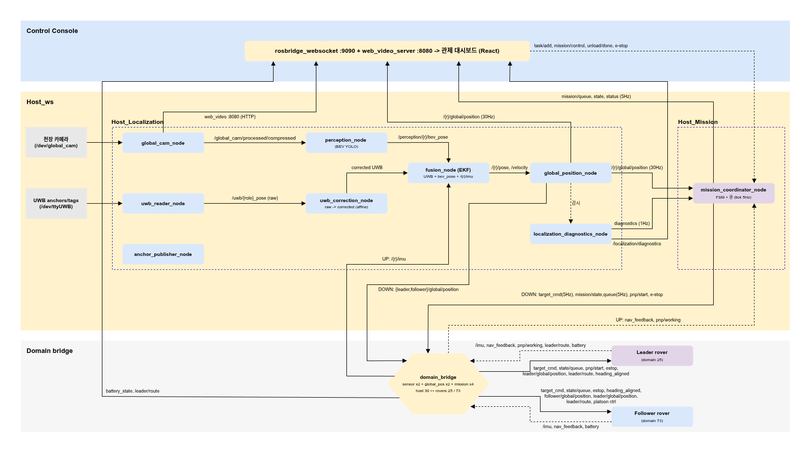

# Multi-Rover Localization & Factory Control — Host PC

멀티 로버(리더 + 팔로워) 스마트팩토리의 호스트 PC 소프트웨어.
**UWB · 천장 카메라(YOLO11n-OBB) · IMU**를 융합해 각 로버의 글로벌 위치를 추정하고(`/{robot}/global/position`), Digital Twin 관제 대시보드에서 위치 확인과 미션 지시를 한다.

캡스톤디자인 (2025.09 ~ ) · 3인 팀

## 데모

https://github.com/user-attachments/assets/e5006bd6-a856-4f03-865a-56b9399dfea6

왼쪽은 Digital Twin 화면(추정 위치와 경로), 오른쪽은 천장 카메라 BEV 화면이다.

## 시스템 구성



| 계층 | 구성 |
|------|------|
| 센서 입력 | 천장 카메라 → `global_cam_node` → `perception_node`(YOLO11n-OBB, 로버 위치·방향) / UWB 태그 → `uwb_reader_node` → `uwb_correction_node`(affine 보정) / 로버 IMU(domain_bridge 경유) |
| 위치 추정 | `fusion_node`(로봇별 EKF) → `global_position_node` → `/{robot}/global/position`, `localization_diagnostics_node`(센서 상태 감시) |
| 미션 | `mission_coordinator_node` — 작업 큐와 로봇별 목표 지시(`TargetCommand`) |
| 관제 | `dashboard/` — React + three.js(urdf-loader) Digital Twin, rosbridge·web_video_server, 로버 상태·센서 상태·미션 큐·E-stop |
| 로버 연결 | 로버(Domain 25, 73)와 호스트(Domain 30)를 분리하고 `domain_bridge`로 필요한 토픽만 연결 |

## 위치 추정

`host_localization/fusion/se2nhc.py` — 로봇별 독립 EKF.

- 상태 `[px, py, vx, vy, h_off]` (2D). 방향은 IMU yaw + `h_off`로 두고, 등속 모델로 예측한다.
- 관측
  - UWB 위치: 품질값(qf)에 따라 측정 잡음을 조절하고, Huber 가중으로 튀는 값을 약하게 반영
  - 천장 카메라(BEV) 위치: Mahalanobis 게이트로 기각해 두 로봇 ID가 뒤바뀐 검출을 거른다
  - 측면 속도 0(non-holonomic) 의사 관측: 이동 궤적이 방향 오프셋을 관측하게 한다
  - 직진 구간의 진행 방향(COG)으로 방향 오프셋 보정, 연속으로 약 180° 어긋나면 오프셋을 뒤집어 자가 복구
- 로버 IMU 시각과 호스트 UWB 시각을 한 bag에서 맞추기 위해 chrony로 시계를 동기화하고, 기동 시 `check_imu_sync`가 수신 지연으로 동기 상태를 점검한다.

## 결과

- UWB 정적 오차(36개 지점 레이저 실측 기준, 평균): 보정 전 15.9 cm → affine 보정 11.6 cm (leave-one-out) — `host_ws/src/host_localization/config/uwb_config.yaml`

## 역할

| 담당 | 범위 |
|------|------|
| 구자경 (팀장) | 호스트 PC 전체 — 위치 추정(센서 융합·캘리브레이션), Digital Twin 관제 대시보드, 미션 조율, 로버·매니퓰레이터와의 ROS 2 인터페이스 정의, 시간 동기화·Domain 연결 |
| 팀원 | 로버 경로 계획·주행 제어 |
| 팀원 | 매니퓰레이터 pick & place |

로버 측 인터페이스 예시: `host_ws/src/rover_nav_ref/`

## 요구 사항
- Ubuntu 22.04 · ROS 2 Humble · NVIDIA GPU (CUDA 12.4+)
- UWB 모듈(DWM1001) + 천장 카메라(Logitech BRIO) — 둘 다 USB 연결

## 실행

```bash
git clone https://github.com/JaGyeong1024/Multi-Rover-Localization-and-Factory-Control.git ~/capstone
cd ~/capstone
bash setup/setup.sh             # 1회: udev · 의존성 · CUDA venv · 대시보드 deps · 빌드
# (안내가 뜨면 1회 재로그인) → UWB 동글 + 카메라 USB 연결

bash host_ws/run_pipeline.sh    # 위치추정만 → /{robot}/global/position 발행
bash host_ws/run_dashboard.sh   # 전체 + 관제 대시보드 → http://localhost:5173
```

YOLO 모델과 카메라 캘리브레이션이 레포에 포함되어 **clone만으로 바로 실행**된다.

## 디렉토리

| 경로 | 역할 |
|------|------|
| `host_ws/` | ROS 2 워크스페이스 — 센서 융합(EKF) + perception 노드 + 미션 + 실행 스크립트 |
| `dashboard/` | 웹 관제 UI (Vite + React + three.js, rosbridge / web_video) |
| `setup/` | 1회 머신 세팅 (udev · 의존성 · 캘리브레이션) |
| `data/` | 런타임 모델 가중치 + 카메라 캘리브레이션 |
