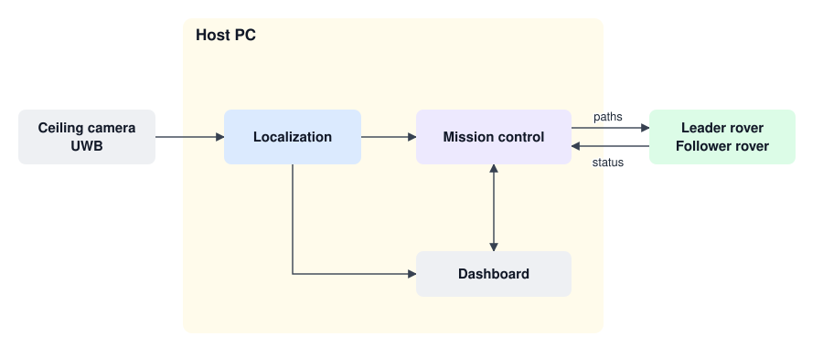
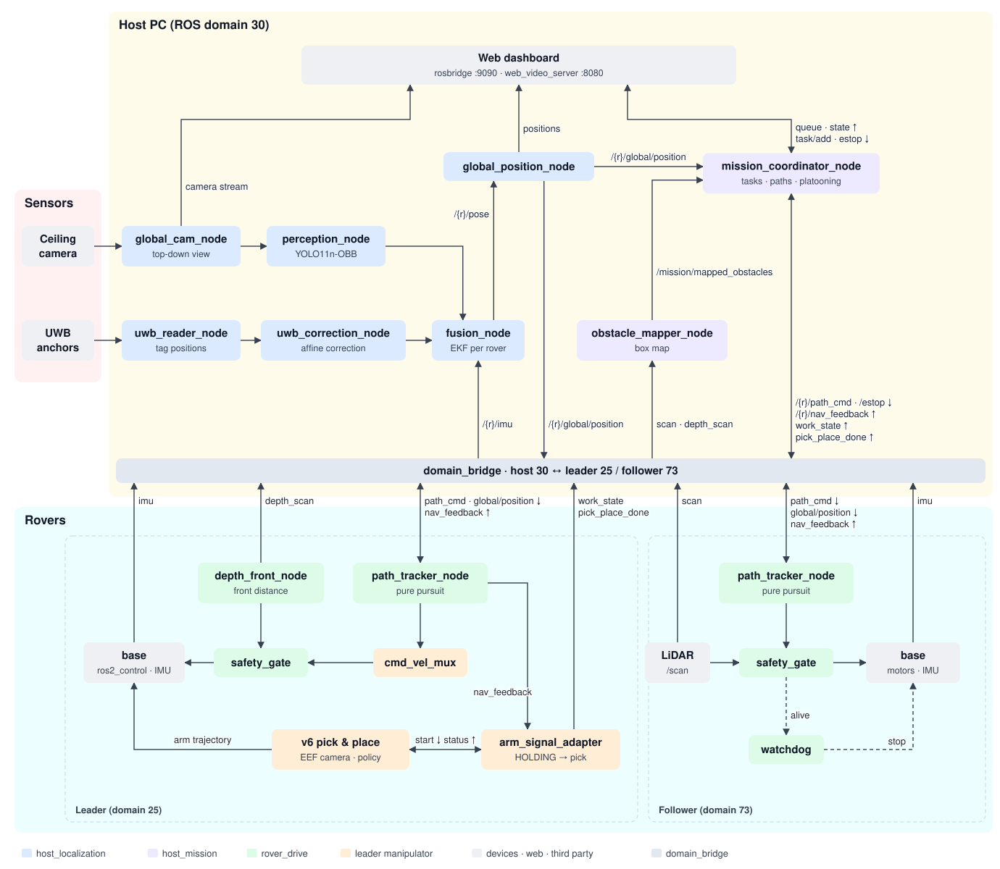

# Multi-Rover Localization & Factory Control

🏆 [**2nd place** (최우수상) · 2026 Capstone Design Competition](https://github.com/JaGyeong1024/JaGyeong1024/blob/main/assets/awards/2026-capstone-design.pdf)<br>
🏆 [**3rd place** (장려상) · 5th Chungbuk AI Achievement Presentation](https://github.com/JaGyeong1024/JaGyeong1024/blob/main/assets/awards/2026-chungbuk-ai-achievement-presentation.pdf)

[](https://github.com/JaGyeong1024/Multi-Rover-Localization-and-Factory-Control/actions/workflows/ci.yml)


[](LICENSE)

Two rovers working together on an indoor factory floor. The leader picks a part from a shelf
with its manipulator and loads it onto the follower, which carries it to the unloading point.
A host PC tracks both rovers with a ceiling camera and UWB, plans their paths, and runs a web
dashboard for queuing tasks and watching the system.

## Team

<table>
<tr>
<td align="center" valign="top" width="200">
  <a href="https://github.com/JaGyeong1024"></a><br />
  <a href="https://github.com/JaGyeong1024"><b>구자경</b></a> <sub>Team Lead</sub><br />
  <sub>Localization<br />Path Planning · Platooning<br />Dashboard · Communication</sub>
</td>
<td align="center" valign="top" width="200">
  <a href="https://github.com/KweonTJ"></a><br />
  <a href="https://github.com/KweonTJ"><b>권택주</b></a><br />
  <sub>Hardware<br />Manipulator Control<br />Manipulator Perception</sub>
</td>
<td align="center" valign="top" width="200">
  <a href="https://github.com/kim-salim"></a><br />
  <a href="https://github.com/kim-salim"><b>김사림</b></a><br />
  <sub>Path Planning<br />AMR Control<br />Camera Calibration</sub>
</td>
</tr>
</table>

## Demo video

https://github.com/user-attachments/assets/845f1e4f-d76a-46f5-9f1b-6f3f57fef8ed

Top: the rovers. Bottom: the control dashboard.

## System overview

<p align="center"></p>

| Package | Role |
|---|---|
| `host_localization` | Localization of both rovers |
| `host_planning` | Path planning |
| `host_mission` | Task sequencing and coordination of both rovers |
| `host_mission_interfaces` | Host–rover messages |
| `rover_ws/rover_drive` | Path following and front-obstacle stop on the rover |
| `rover_ws/` leader packages | Leader bringup and manipulator pick-and-place ([list](rover_ws/README.md)) |
| `host_sim` | Simulator for running without hardware |
| `dashboard/` | Web control dashboard |

## Methods

**Localization**
- Detects the rovers in the ceiling camera image with YOLO11n-OBB.
- Fuses camera position, UWB position and rover IMU with one EKF per rover.
- Keeps tracking from UWB and IMU while the camera view is blocked.

**Path planning**
- Without obstacles, a quintic Bézier curve gives a forward path with continuous curvature.
- Where the curve would break the minimum turning radius, a Dubins path is used instead.
- With obstacles, grid A\* finds via points, which are joined with the same curves.
- The rover follows the received path with pure pursuit.

**Platooning**
- The follower shares the leader's path at a set gap and yields where their paths cross.
- Boxes on the floor are mapped from the rovers' LiDAR and depth camera; a blocked path is re-planned.

## Nodes and topics

`{r}` is `leader` or `follower`. The host and each rover run on separate ROS domains;
the topics passed between them are listed in the `domain_bridge` configs (`*/config/bridge_*.yaml`).

<p align="center"></p>

| Node | What it does |
|---|---|
| `uwb_reader_node` | Reads tag positions from the UWB module's serial output |
| `uwb_correction_node` | Applies an affine correction to UWB positions |
| `global_cam_node` | Turns the ceiling camera image into a top-down (BEV) view |
| `perception_node` | Detects both rovers in the BEV image with YOLO11n-OBB |
| `fusion_node` | Fuses camera, UWB and IMU with one EKF per rover |
| `global_position_node` | Publishes the final position on `/{robot}/global/position` |
| `obstacle_mapper_node` | Maps boxes on the floor from the follower LiDAR and the leader depth camera |
| `mission_coordinator_node` | Runs the task queue and plans and sends both rovers' paths |
| `path_tracker_node` | Follows the received path with pure pursuit |
| `safety_gate_node` | Stops the rover on a front obstacle, lost localization or E-stop; the only `/cmd_vel` publisher |
| `cmd_watchdog_node` | Stops the rover if the safety gate goes silent |
| `depth_front_node` | Front distance and scan from the leader's depth camera |
| `cmd_vel_mux` | Leader: passes the path tracker's command to the safety gate |
| `arm_signal_adapter` | Leader: starts the pick when the leader holds at a shelf, reports the pick result to the host |
| v6 pick & place | Leader: arm grasp sequence with an end-effector camera and a learned policy correction |

## Getting started

### Simulator (no hardware)

Requires Ubuntu 22.04, ROS 2 Humble and Node.js 18+.

```bash
git clone https://github.com/JaGyeong1024/Multi-Rover-Localization-and-Factory-Control.git
cd Multi-Rover-Localization-and-Factory-Control
source /opt/ros/humble/setup.bash
rosdep install -y --from-paths host_ws/src rover_ws/src/rover_drive --ignore-src
sudo apt install -y ros-humble-rosbridge-suite
(cd host_ws && colcon build --symlink-install)
(source host_ws/install/setup.bash && cd rover_ws && colcon build --symlink-install --packages-select rover_drive)
(cd dashboard && npm install)

bash host_ws/run_sim.sh
```

Open http://localhost:5173 and add a part to the queue; the two simulated rovers carry out the task.

### Real hardware

- Host: Ubuntu 22.04, ROS 2 Humble, NVIDIA GPU
- Sensors: UWB modules (DWM1001), ceiling camera (Logitech BRIO)
- Rovers: TurtleBot3-based, Jetson Orin Nano

```bash
bash setup/setup.sh          # one-time host setup
bash host_ws/run_host.sh     # localization + mission control + dashboard
```

Copy `rover_ws/` and `config/` side by side onto each rover, build `rover_ws`, then start it.
The leader's manipulator packages and their external dependencies are listed in
[`rover_ws/README.md`](rover_ws/README.md).

```bash
bash rover_ws/run_leader.sh start
bash rover_ws/run_follower.sh start
```

## Adapting to another site or hardware

Everything that depends on the site or the hardware is in [`config/`](config/):

- `config/site/`: work area, shelf positions, goal poses, parts, UWB anchor positions
- `config/hardware/`: rover dimensions, sensor mounts, camera settings
- If the ceiling camera moves, recalibrate with [`host_localization/scripts/`](host_ws/src/host_localization/scripts/).

The system assumes one leader and one follower.

## Tests

```bash
source /opt/ros/humble/setup.bash && source host_ws/install/setup.bash
for p in host_localization host_mission host_planning host_sim; do
  (cd host_ws/src/$p && python3 -m pytest test -q)
done
(cd rover_ws/src/rover_drive && python3 -m pytest test -q)
bash host_ws/run_scenarios.sh    # full task runs over several box layouts (~10 min)
```

## License

[MIT](LICENSE)
